# Performance Testing Suite - Gems Backend API

Dokumentasi ini berisi panduan lengkap mengenai pengujian performa menggunakan k6 untuk proyek Gems Backend.

## Daftar Isi
1. [Apa itu Performance Test?](#1-apa-itu-performance-test)
2. [Apa itu k6?](#2-apa-itu-k6)
    * [Hello World k6](#hello-world-k6)
3. [Mapping API Collection ke Script k6](#3-mapping-api-collection-ke-script-k6)
4. [Struktur Proyek](#4-struktur-proyek)
5. [Panduan Instalasi dan Menjalankan k6](#5-panduan-instalasi-dan-menjalankan-k6)
    * [Langkah 1: Instalasi](#langkah-1-instalasi)
    * [Langkah 2: Verifikasi](#langkah-2-verifikasi)
    * [Langkah 3: Hello World k6](#langkah-3-hello-world-k6)
    * [Langkah 4: Konfigurasi Login & Menjalankan Test](#langkah-4-konfigurasi-login--menjalankan-test)
        * [A. Logika Login Program](#a-logika-login-program)
        * [B. Cara Menjalankan Test](#b-cara-menjalankan-test)
    * [Langkah 5: Cara Membaca Hasil Performance Test k6](#langkah-5-cara-membaca-hasil-performance-test-k6)
        * [Cara Membaca Metrik Utama](#cara-membaca-metrik-utama)
6. [Manajemen Source Code & Kolaborasi QA](#6-manajemen-source-code--kolaborasi-qa)
7. [Service Level Agreement (SLA)](#7-service-level-agreement-sla)
8. [Autoscaling & Infrastruktur (GKE)](#8-autoscaling--infrastruktur-gke)
9. [Optimasi TCP Connection & Handshake](#9-optimasi-tcp-connection--handshake)

---

## 1. Apa itu Performance Test?
**Performance Test** adalah jenis pengujian perangkat lunak yang dilakukan untuk memastikan aplikasi berjalan dengan baik di bawah beban kerja tertentu. Tujuan utamanya bukan untuk menemukan bug fungsional, melainkan untuk menghilangkan hambatan performa (*bottlenecks*).

Fokus pengujian ini meliputi:
*   **Speed**: Menentukan seberapa cepat aplikasi merespons.
*   **Scalability**: Menentukan beban maksimum pengguna yang dapat ditangani.
*   **Stability**: Menentukan apakah aplikasi stabil di bawah beban yang bervariasi.

---

## 2. Apa itu k6?
**k6** adalah alat pengujian beban (*load testing*) modern yang bersifat open-source dan berbasis JavaScript. k6 dirancang untuk memberikan pengalaman pengembang terbaik dalam membangun test suite yang performan dan dapat diskalakan.

### Hello World k6
File: `test-koneksi.js`
Script ini adalah contoh sederhana (*Hello World*) untuk memvalidasi apakah k6 sudah terinstal dan dapat menjalankan perintah dasar.

```javascript
import http from 'k6/http';
import { sleep } from 'k6';

export default function () {
    // Melakukan GET request sederhana ke website testing k6
    http.get('https://test.k6.io');
    sleep(1);
}
```
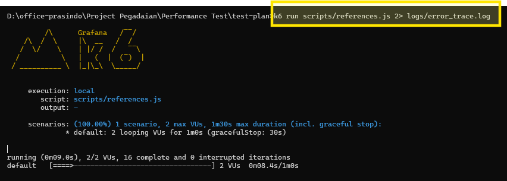

---

## 3. Mapping API Collection ke Script k6
Proyek ini mengotomatisasi konversi dari **Postman Collection** menjadi script k6 yang terorganisir per Resource (folder). Setiap folder di Postman akan menjadi satu file `.js` di dalam folder `scripts/`.

---

## 4. Struktur Proyek
Struktur direktori diatur secara modular untuk memudahkan pengelolaan:

*   **`api-collection/`**: Berisi file JSON Postman Collection asli yang menjadi sumber data skrip.
*   **`lib/`**: Berisi helper utama dan fungsi reusable, seperti `auth_helper.js` untuk proses login.
*   **`scritps/`**: Berisi seluruh skrip pengujian k6 yang dipisahkan berdasarkan modul API (misal: `references.js`, `news.js`).
*   **`logs/`**: Tempat penyimpanan hasil laporan pengujian dalam format `.txt` (tracing metrik dan error).
*   **`k6-panduan-installasi/`**: Folder khusus penyimpanan aset gambar dan screenshot untuk dokumentasi ini.
*   **`main.js`**: Runner utama yang mengonsolidasikan seluruh skenario untuk dijalankan bersamaan.

---

## 5. Panduan Instalasi dan Menjalankan k6

### Langkah 1: Instalasi
Download installer k6 melalui situs resmi atau gunakan package manager.
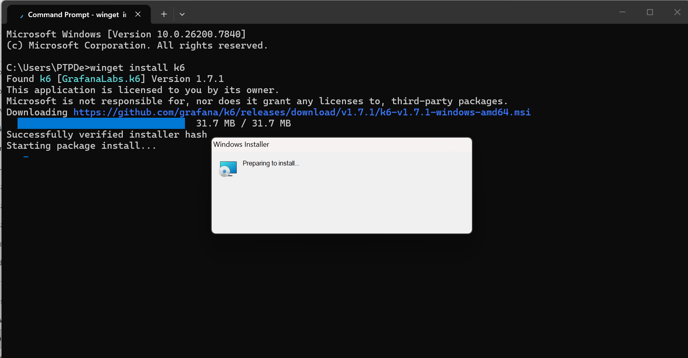

### Langkah 2: Verifikasi
Buka terminal (CMD/PowerShell) dan ketik `k6 version`. Jika muncul versi k6, maka instalasi sukses.


### Langkah 3: Hello World k6
Jalankan perintah berikut untuk mengetes k6 pertama kali:
`k6 run test-koneksi.js`
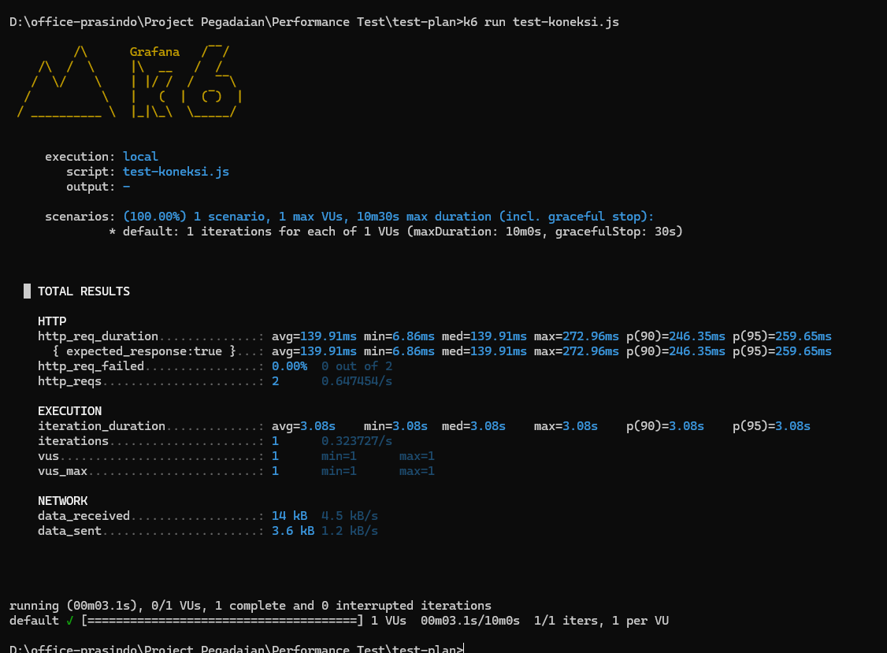


### Langkah 4: Konfigurasi Login & Menjalankan Test

#### A. Logika Login Program
File: `lib/auth_helper.js`
Sebelum menjalankan test utama, pastikan modul login sudah dikonfigurasi dengan kredensial yang benar. Modul ini digunakan untuk mendapatkan Bearer Token.

```javascript
export function login() {
    const url = `${baseUrl}/api/v1/login`;
    const payload = JSON.stringify({
        username: "super",
        password: "super123"
    });
    const res = http.post(url, payload, { headers: { 'Content-Type': 'application/json' } });
    
    if (res.status === 200) {
        const body = res.json();
        if (body.data && body.data.token) {
            return body.data.token; // Mengembalikan Bearer Token
        }
    }
    console.error("Login failed!");
    return null;
}
```

#### B. Cara Menjalankan Test
Setelah konfigurasi siap, Anda bisa menjalankan per file resource atau menggunakan Runner utama.

**Menjalankan Resource Tertentu:**
`k6 run scripts/references.js 2> logs/trace-references.log`

Setting Skenario & Virtual User:
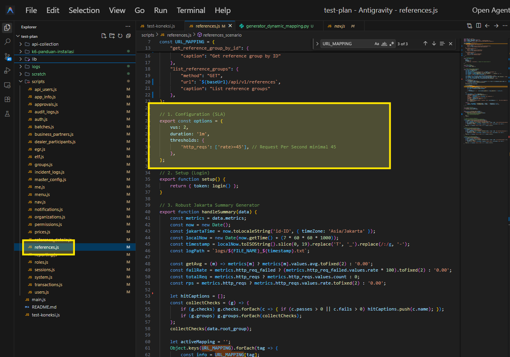

Setting Running Hit Endpoint API:
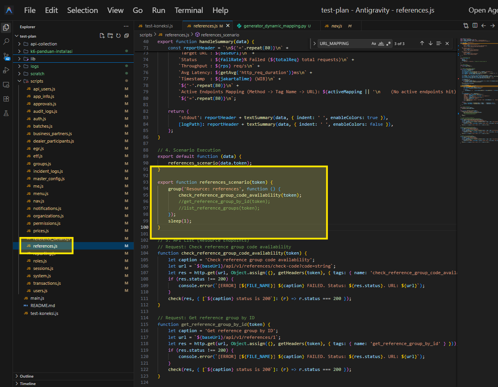

Result Performance Test:
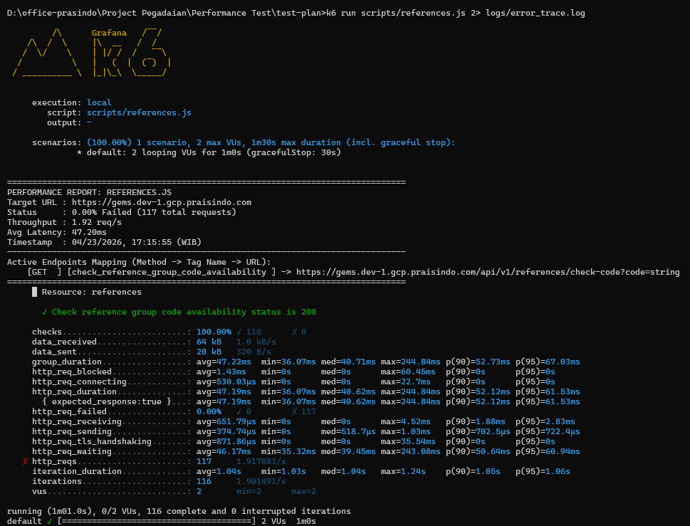


**Menjalankan Seluruh API (Parallel):**
`k6 run main.js logs/main.log`

Setting Skenario & Virtual User:


Result Performance Test:
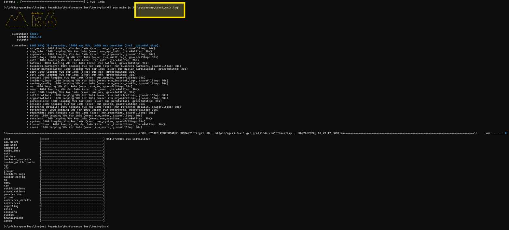


### Langkah 5: Cara Membaca Hasil Performance Test k6
Setelah selesai, k6 akan menampilkan ringkasan performa di terminal dan menyimpan log detail di folder `logs/`.


#### Cara Membaca Metrik Utama:
Berikut adalah penjelasan metrik yang paling penting untuk dipantau:

*   **`http_req_duration` (Latency)**: Waktu yang dibutuhkan server untuk merespons permintaan.
    *   `avg`: Rata-rata waktu respon.
    *   `p(95)`: 95% permintaan memiliki waktu respon di bawah angka ini (standar industri untuk performa).
*   **`http_reqs` (Throughput)**: Jumlah total permintaan dan rata-rata permintaan per detik (RPS). Contoh: `1.922973/s` berarti sekitar 2 permintaan per detik.
*   **`checks` (Success Rate)**: Persentase keberhasilan pengujian berdasarkan kriteria yang ditentukan (misal: status 200).
*   **`http_req_failed` (Error Rate)**: Persentase permintaan yang gagal. Idealnya harus **0.00%**.
*   **`vus` (Virtual Users)**: Jumlah pengguna virtual yang aktif mensimulasikan beban selama pengujian.
*   **`iterations`**: Jumlah total skenario yang berhasil diselesaikan oleh seluruh VUs.
*   **`iteration_duration`**: Waktu rata-rata yang dibutuhkan untuk menyelesaikan satu siklus skenario (dari awal hingga akhir, termasuk waktu `sleep`).

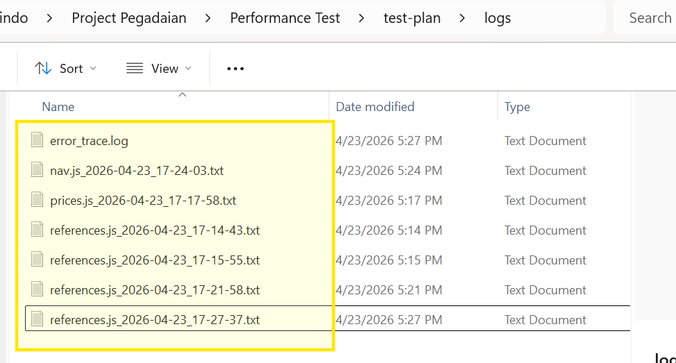
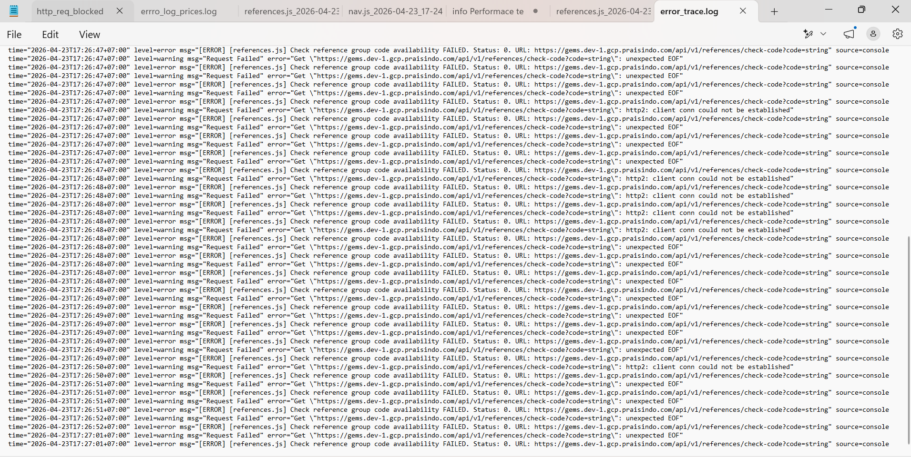

---

## 6. Manajemen Source Code & Kolaborasi QA
Proyek ini didesain secara **Modular**, yang artinya setiap kelompok API dipisahkan ke dalam file yang berbeda. Struktur ini sangat mendukung kerja sama tim QA dalam jumlah banyak secara bersamaan (*Collaborative Testing*).

### Alur Kerja Kolaborasi (Git Workflow)
Dengan menggunakan sistem Git, tim QA dapat berbagi tugas tanpa saling mengganggu kode satu sama lain.

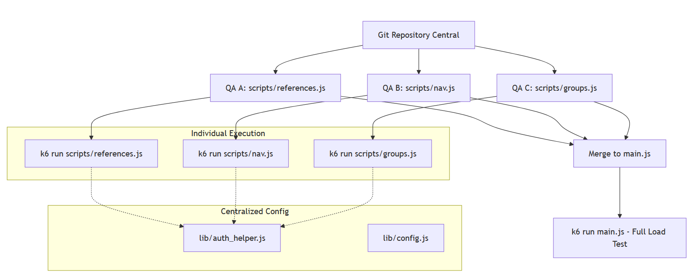

### Keuntungan Struktur Modular:
1.  **No Conflict**: QA A tidak akan bentrok dengan QA B karena mengedit file yang berbeda.
2.  **Reusable**: Fungsi Login dan Header hanya perlu dikonfigurasi satu kali di folder `lib/`.
3.  **Easy Maintenance**: Jika ada perubahan pada satu endpoint, cukup perbaiki satu file yang bersangkutan.
4.  **Flexible Execution**: Setiap skrip di dalam `scripts/*.js` dapat dijalankan secara mandiri untuk pengujian unit API, atau digabungkan dalam `main.js` untuk simulasi beban penuh.

---
## 7. Service Level Agreement (SLA)

Bagian ini mendefinisikan standar keberhasilan untuk Performance Test yang dilakukan:

### 1.1 Alat Pengujian
*   **Tool**: k6 (Grafana k6)

### 1.2 Skenario Load Testing
Pengujian dilakukan dengan skenario bertahap (*Step Load*):
*   **Tier 1**: 60 Virtual Users (VU) dengan waktu Ramp-up 60 detik.
*   **Tier 2**: 120 Virtual Users (VU) dengan waktu Ramp-up 120 detik.
*   **Tier 3**: 200 Virtual Users (VU) dengan waktu Ramp-up 200 detik.

### 1.3 Kriteria Keberhasilan (Acceptance Criteria)
Aplikasi dianggap lulus pengujian jika memenuhi ambang batas berikut:
*   **Response Time**: P90 (90% dari total request) harus di bawah **5 detik**.
*   **Error Rate**: Harus **0%** (tidak diperbolehkan ada kegagalan request HTTP).

---

## 8. Autoscaling & Infrastruktur (GKE)

Untuk menangani beban tinggi saat pengujian (hingga 200 VU), infrastruktur menggunakan **Horizontal Pod Autoscaler (HPA)** pada Google Kubernetes Engine (GKE).

### 8.1 Konfigurasi Deployment
File konfigurasi [gems-backend-deployment.yaml](gke/gems-backend-deployment.yaml) mengatur sumber daya dasar untuk setiap pod:
*   **CPU Request**: 200m (0.2 Core)
*   **Memory Request**: 512Mi
*   **Memory Limit**: 1Gi

### 8.2 Mekanisme Autoscaling (HPA)
Sistem akan menambah jumlah pod secara otomatis berdasarkan metrik berikut:
*   **Min Replicas**: 2 Pod (Ketersediaan minimum)
*   **Max Replicas**: 15 Pod (Batas maksimal ekspansi saat beban puncak)
*   **Target CPU**: 60% (Scale up jika rata-rata CPU > 60%)
*   **Target Memory**: 70% (Scale up jika rata-rata RAM > 70%)

Hal ini memastikan aplikasi tetap stabil dan responsif meskipun jumlah pengguna (Virtual Users) meningkat drastis sesuai skenario SLA.

## 9. Optimasi TCP Connection & Handshake

Saat menjalankan pengujian dengan jumlah Virtual Users (VU) yang besar, sistem operasi mungkin membatasi jumlah koneksi TCP aktif atau kecepatan *handshake* koneksi baru. Hal ini dapat menyebabkan error koneksi atau timeout meskipun aplikasi backend masih sanggup menangani beban.

### 9.1 Gejala Limit TCP
Jika batas TCP belum ditingkatkan, k6 akan menampilkan peringatan terkait kegagalan *handshake* atau kegagalan pembukaan soket baru karena antrean koneksi sistem sudah penuh.

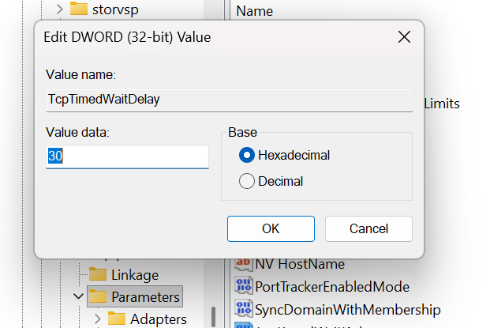

### 9.2 Optimasi Koneksi (Windows)
Pada Windows, optimasi dilakukan dengan menyesuaikan parameter TCP stack agar mengizinkan lebih banyak koneksi simultan dan mempercepat proses pelepasan port yang sudah selesai digunakan (*TIME_WAIT*).


### 9.3 Verifikasi Handshake
Setelah optimasi dilakukan, k6 akan dapat melakukan *handshake* ribuan koneksi secara stabil tanpa ada lonjakan error di awal pengujian (*ramp-up phase*).


---

*Dibuat untuk Tim Performance Test - Praisindo Project Pegadaian*
