# Performance Testing Suite - k6

Dokumentasi ini berisi panduan lengkap pengujian performa (*load testing & stress testing*) menggunakan **k6**, mencakup persiapan Mock API Server, integrasi Postman, eksekusi skrip k6 modular, analisis hasil metrik, diagram arsitektur pengujian, hingga sampel dokumen laporan resmi.

---

## 📑 Daftar Isi
1. [Apa itu Performance Test?](#1-apa-itu-performance-test)
    * [Tipe-Tipe Performance Testing](#tipe-tipe-performance-testing)
2. [Apa itu k6 & Hello World](#2-apa-itu-k6--hello-world)
3. [Struktur Proyek](#3-struktur-proyek)
4. [Menjalankan Mock API Server](#4-menjalankan-mock-api-server)
5. [Pengujian Endpoint via Postman (Uji Fungsional Awal)](#5-pengujian-endpoint-via-postman-uji-fungsional-awal)
6. [Panduan Instalasi & Eksekusi k6](#6-panduan-instalasi--eksekusi-k6)
    * [Langkah 1: Instalasi k6](#langkah-1-instalasi-k6)
    * [Langkah 2: Verifikasi Instalasi](#langkah-2-verifikasi-instalasi)
    * [Langkah 3: Performance Test Modul Login](#langkah-3-performance-test-modul-login)
    * [Langkah 4: Performance Test Modul Reference (CRUD)](#langkah-4-performance-test-modul-reference-crud)
    * [Langkah 5: Menjalankan Seluruh Modul Secara Paralel (main.js)](#langkah-5-menjalankan-seluruh-modul-secara-paralel-mainjs)
7. [Hasil Pengujian & Sampel Laporan (Report PDF)](#7-hasil-pengujian--sampel-laporan-report-pdf)
    * [Cara Membaca Metrik Utama](#cara-membaca-metrik-utama)
    * [Download Dokumen Sampel Report](#download-dokumen-sampel-report)
8. [Manajemen Source Code & Kolaborasi QA (design/colaboration.jpg)](#8-manajemen-source-code--kolaborasi-qa)
    * [8.1 Diagram Alur Kerja Kolaborasi QA](#81-diagram-alur-kerja-kolaborasi-qa)
    * [8.2 Keuntungan Arsitektur Modular](#82-keuntungan-arsitektur-modular)
9. [Service Level Agreement (SLA)](#9-service-level-agreement-sla)
10. [Optimasi TCP Connection & Handshake (Windows)](#10-optimasi-tcp-connection--handshake-windows)

---

## 1. Apa itu Performance Test?
**Performance Test** adalah pengujian perangkat lunak untuk memastikan aplikasi berjalan dengan baik di bawah beban kerja tertentu (*load/stress*). Tujuannya adalah mengidentifikasi dan menghilangkan hambatan performa (*bottlenecks*).

Fokus utama pengujian ini meliputi:
*   **Speed**: Seberapa cepat aplikasi merespons request pengguna.
*   **Scalability**: Berapa kapasitas beban maksimum (Virtual Users) yang dapat ditangani.
*   **Stability**: Apakah aplikasi stabil di bawah beban tinggi yang konstan maupun lonjakan drastis.

### Tipe-Tipe Performance Testing
Pengujian performa dibagi menjadi beberapa jenis pengujian sesuai tujuan dan skenario beban:

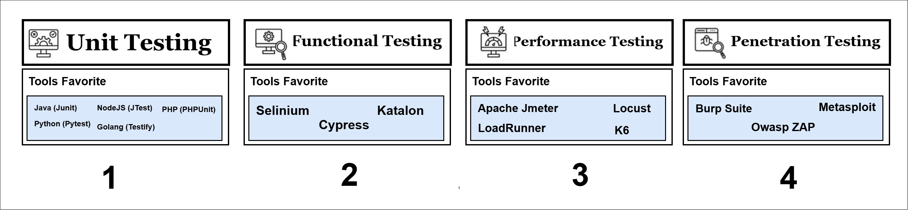

*   **Load Testing**: Menguji perilaku sistem di bawah beban pengguna normal yang diharapkan.
*   **Stress Testing**: Menguji batas kemampuan maksimal sistem hingga titik kegagalan (*breaking point*).
*   **Spike Testing**: Menguji ketahanan sistem saat terjadi lonjakan traffic pengguna yang tiba-tiba.
*   **Endurance / Soak Testing**: Menguji stabilitas dan kemungkinan kebocoran memori (*memory leak*) di bawah beban konstan dalam durasi panjang.
*   **Scalability Testing**: Menguji efektivitas sistem saat kapasitas hardware atau pod diperluas (*scale-out*).

---

## 2. Apa itu k6 & Hello World
**k6** adalah alat pengujian beban (*load testing*) modern open-source berbasis Go dan JavaScript ES6. k6 dirancang untuk memberikan performa tinggi dengan konsumsi memori yang sangat efisien.

### Hello World k6 (`test-koneksi.js`)
File ini digunakan untuk memvalidasi koneksi dan memastikan k6 bekerja dengan benar:

```javascript
import http from 'k6/http';
import { sleep } from 'k6';

export default function () {
    http.get('https://test.k6.io');
    sleep(1);
}
```

Jalankan perintah berikut:
```bash
k6 run test-koneksi.js
```


---

## 3. Struktur Proyek
Struktur direktori ditata secara modular agar mudah dipelajari oleh pemula dan siap untuk kolaborasi tim QA:

```text
k6-performance-test/
├── api-server/                     # Mock API Server Node.js (In-Memory Data)
│   ├── data/                       # Mock data JSON (references.json, news.json)
│   ├── server.js                   # Server HTTP Node.js (Zero Dependencies)
│   ├── server-express.js           # Server versi Express.js
│   └── package.json
├── api-payload/                    # Koleksi Postman & Contoh Request Body JSON
│   ├── k6-api-collection.postman_collection.json
│   ├── k6-api-environment.postman_environment.json
│   ├── login-payload.json
│   ├── reference-create-payload.json
│   └── news-create-payload.json
├── design/                         # Diagram Desain Arsitektur & Alur Kerja
│   ├── colaboration.jpg            # Diagram Alur Kerja & Kolaborasi Tim QA
│   ├── tipe-testing.jpg            # Diagram Visual Jenis-Jenis Pengujian Performa
│   └── design.drawio               # File Sumber Diagram Arsitektur (Draw.io)
├── lib/                            # Reusable Helpers
│   └── auth_helper.js              # Helper fungsi login & penyedia Authorization Header
├── scripts/                        # Skrip Pengujian k6 per Modul
│   ├── login.js                    # Testing login endpoint & penerimaan Bearer token
│   ├── reference.js                # Testing CRUD modul Reference
│   └── news.js                     # Testing CRUD modul News
├── logs/                           # Tempat penyimpanan hasil test (.log / .txt)
├── main.js                         # Runner utama pengujian multi-skenario (paralel)
├── report-performance-test.pdf     # Sampel laporan resmi Performance Test (PDF)
├── report-performance-test.docx    # Sampel laporan resmi Performance Test (Word)
└── k6-panduan-installasi/          # Aset dokumentasi dan screenshot panduan
```

---

## 4. Menjalankan Mock API Server
Sebelum menjalankan k6 atau Postman, jalankan mock API server di terminal:

```bash
cd api-server
npm start
```
Server akan aktif di `http://127.0.0.1:8080`.

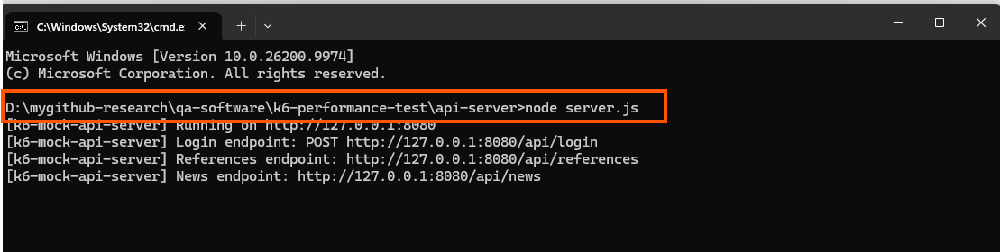

---

## 5. Pengujian Endpoint via Postman (Uji Fungsional Awal)
Sebelum melakukan stress testing dengan k6, validasi endpoint menggunakan Postman:

1. Import file `api-payload/k6-api-collection.postman_collection.json` dan `api-payload/k6-api-environment.postman_environment.json` ke Postman:

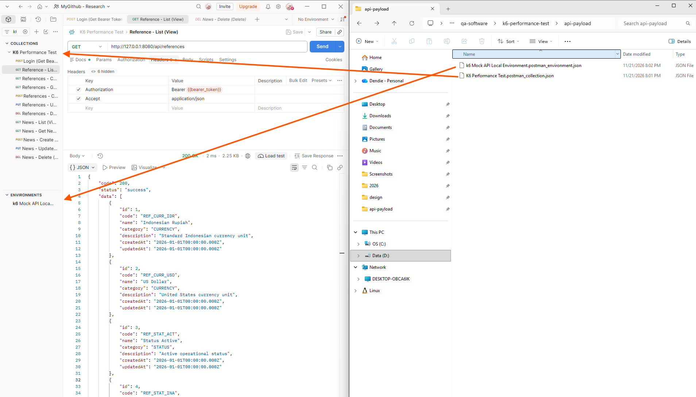

2. Jalankan request **Login** di folder `01 - Authentication`. Token otomatis tersimpan ke environment variable `bearer_token`:

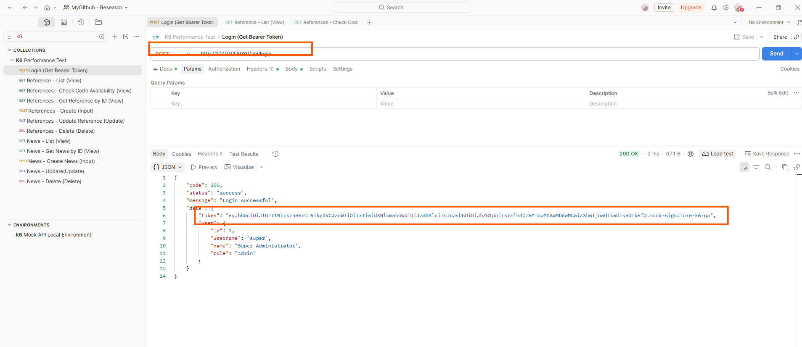

3. Uji endpoint **Reference** (View list, detail, create, update, delete) dengan header Bearer Token yang sudah terpasang otomatis:

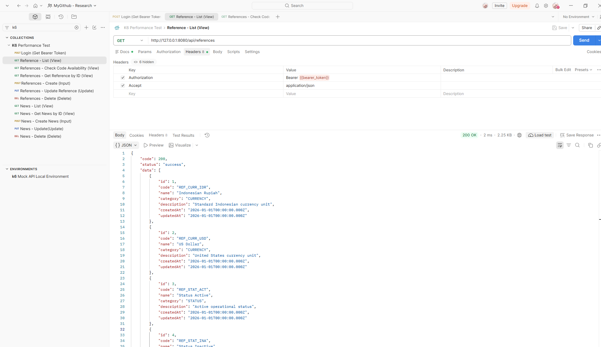
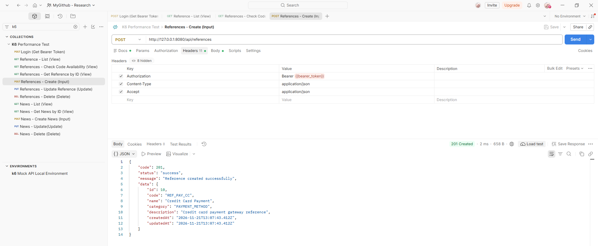

---

## 6. Panduan Instalasi & Eksekusi k6

### Langkah 1: Instalasi k6
Download installer resmi k6 untuk Windows atau gunakan package manager:
```powershell
winget install k6 --source winget
```


### Langkah 2: Verifikasi Instalasi
Buka terminal dan pastikan k6 sudah terpasang:
```bash
k6 version
```

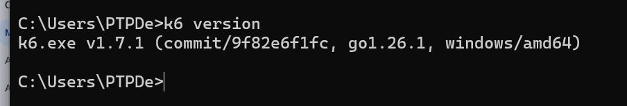

---

### Langkah 3: Performance Test Modul Login
File: `scripts/login.js`

1. Sesuaikan variabel jumlah pengguna simulasi (`VUS`) dan lama pengujian (`DURATION`) pada skrip:

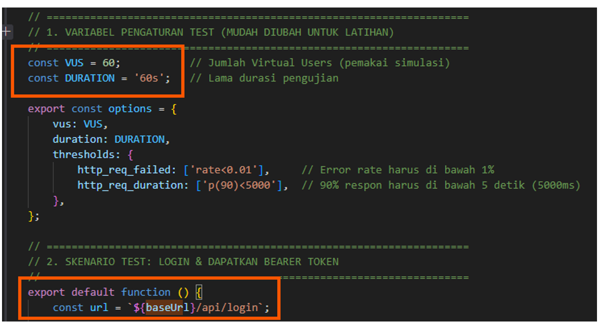

2. Jalankan pengujian:
```bash
k6 run scripts/login.js
```

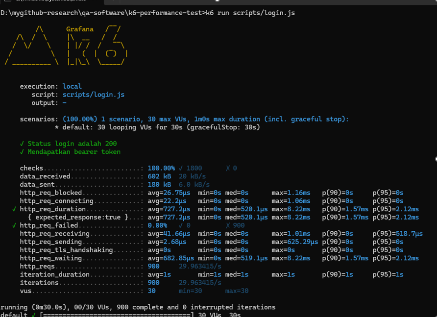

---

### Langkah 4: Performance Test Modul Reference (CRUD)
File: `scripts/reference.js`

1. Konfigurasi `VUS`, `DURATION`, dan fungsi endpoint yang ingin diuji:

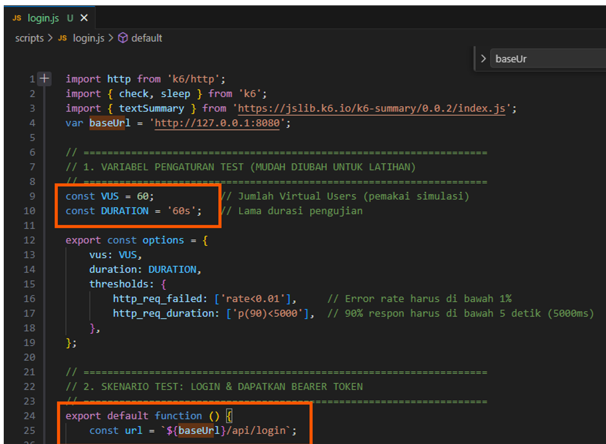

2. Jalankan pengujian:
```bash
k6 run scripts/reference.js
```

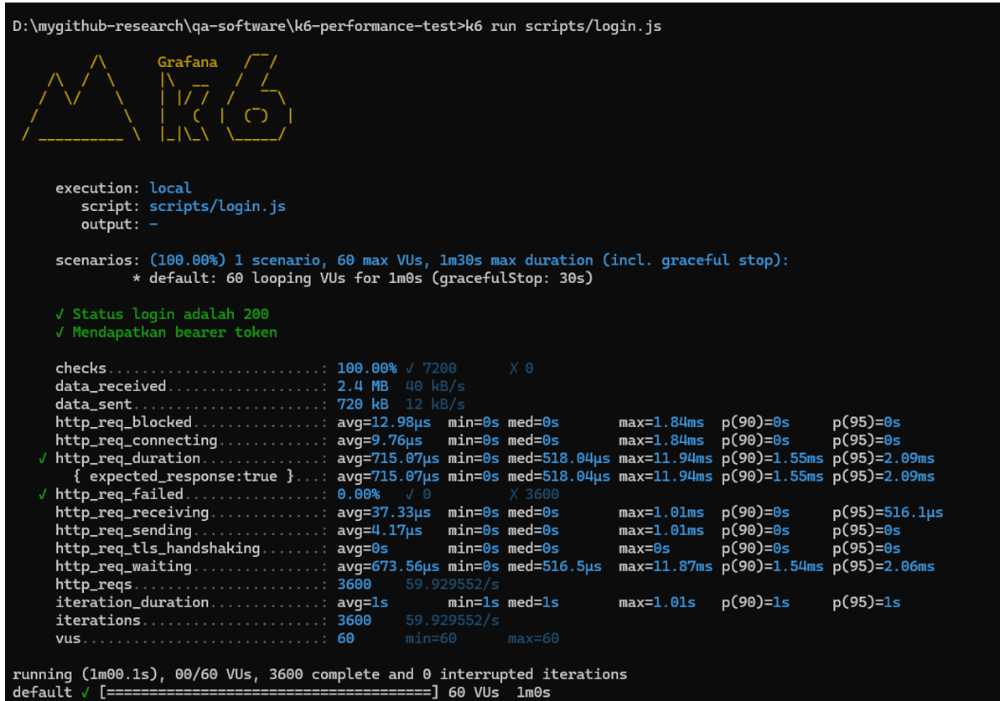

---

### Langkah 5: Menjalankan Seluruh Modul Secara Paralel (main.js)
File: `main.js`

Runner utama mengeksekusi modul `login`, `reference`, dan `news` secara bersamaan menggunakan fitur **multi-scenario** k6:

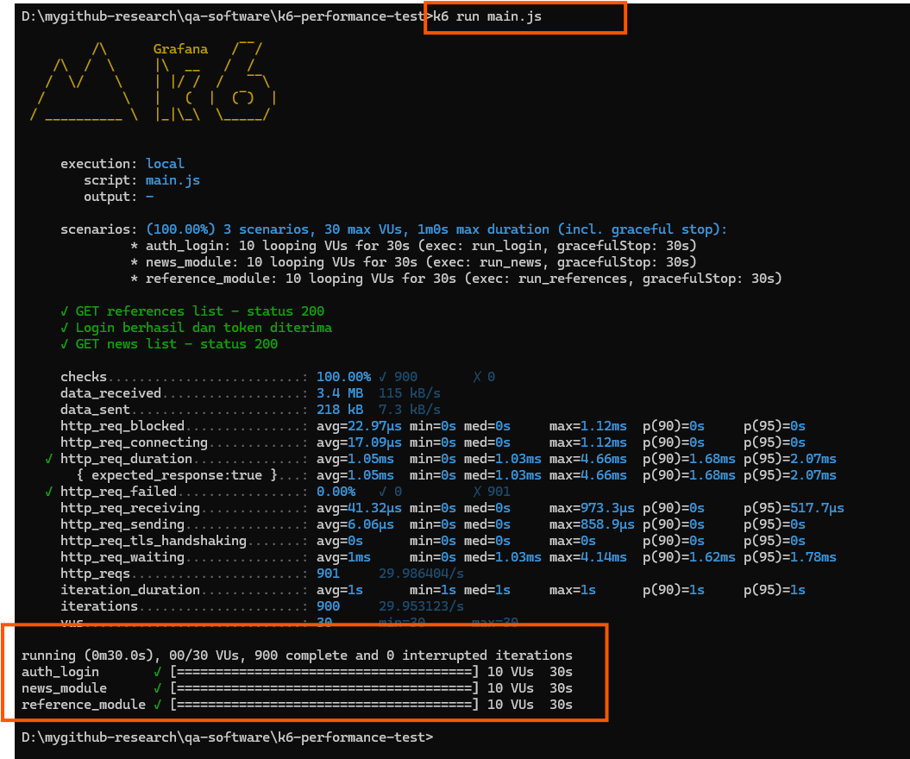

Jalankan perintah berikut:
```bash
k6 run main.js
```

---

## 7. Hasil Pengujian & Sampel Laporan (Report PDF)

### Cara Membaca Metrik Utama
Setelah pengujian selesai, k6 menampilkan tabel metrik performa di terminal dan menyimpan file ke folder `logs/`:

*   **`http_req_duration` (Latency)**: Waktu yang dibutuhkan server untuk merespons permintaan.
    *   `avg`: Rata-rata waktu respon.
    *   `p(90)`: 90% request berada di bawah waktu ini (ambang batas SLA < 5000ms).
    *   `p(95)`: 95% request memiliki waktu respon di bawah angka ini.
*   **`http_reqs` (Throughput)**: Jumlah total request dan rata-rata request per detik (RPS).
*   **`checks` (Tingkat Keberhasilan)**: Persentase validasi status code dan payload yang berhasil.
*   **`http_req_failed` (Tingkat Error)**: Persentase request yang gagal (target SLA: `< 1%` atau `0.00%`).
*   **`vus` (Virtual Users)**: Jumlah pengguna virtual aktif selama pengujian.

Berikut tampilan sampel laporan pengujian performa:

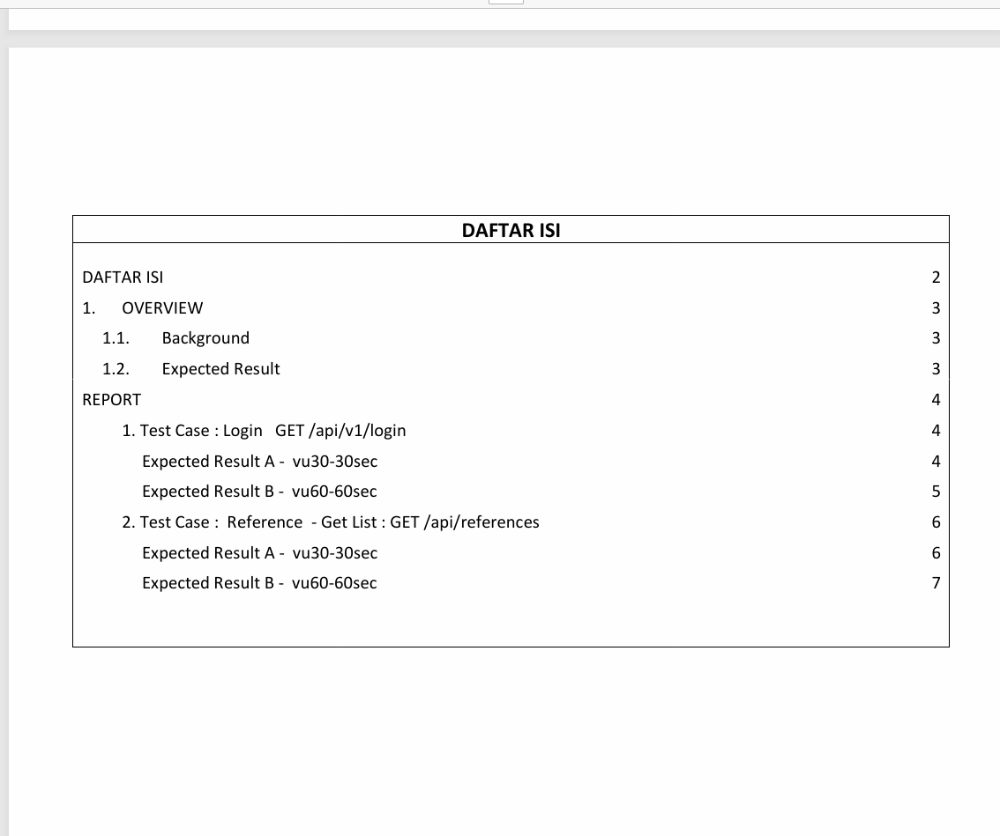
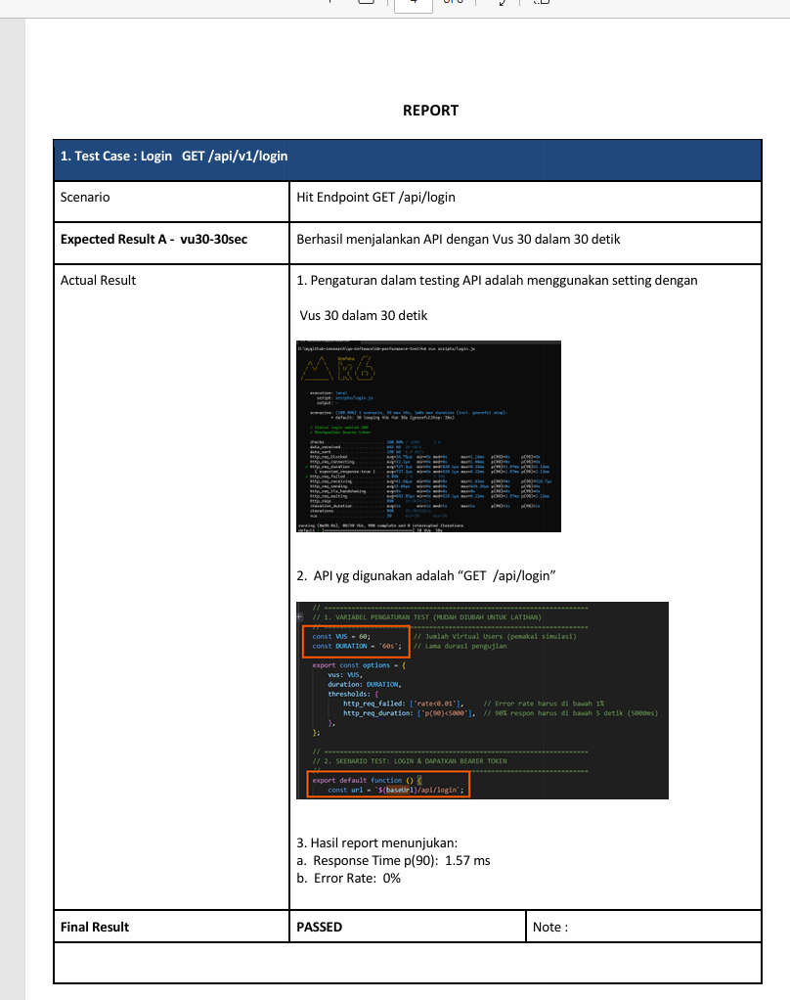

### 📥 Download Dokumen Sampel Report
Dokumen laporan resmi hasil uji performa lengkap (mencakup ringkasan eksekutif, grafik tren, analisis SLA, dan rekomendasi optimasi) dapat diakses melalui link berikut:

*   📄 **[Download report-performance-test.pdf](report-performance-test.pdf)** *(Format PDF siap cetak / presentasi)*
*   📝 **[Download report-performance-test.docx](report-performance-test.docx)** *(Format Word dokumen yang dapat diedit)*

---

## 8. Manajemen Source Code & Kolaborasi QA

Proyek ini mengadopsi prinsip arsitektur modular untuk mendukung kolaborasi tim QA secara simultan tanpa konflik kode.

### 8.1 Diagram Alur Kerja Kolaborasi QA
Berikut adalah diagram alur kerja kolaborasi pengujian performance test (*collaboration workflow*) antar anggota tim QA:

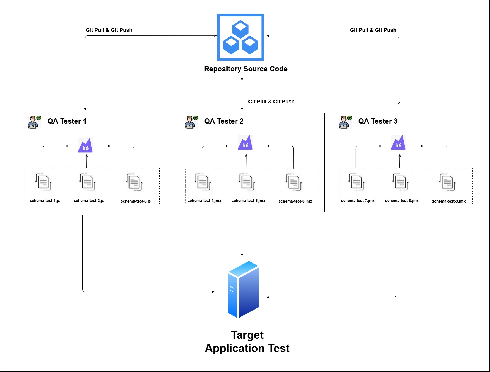

### 8.2 Keuntungan Arsitektur Modular:
1.  **No Merge Conflict**: Setiap QA mengelola file skrip terpisah (`login.js`, `reference.js`, `news.js`) sehingga tidak terjadi tabrakan kode saat melakukan commit dan push ke Git repository.
2.  **Reusable Auth Helper**: Logika login dan pembuatan header Bearer Token diatur terpusat di `lib/auth_helper.js` dan dipakai bersama oleh seluruh skrip.
3.  **Independent Functions**: Setiap endpoint memiliki fungsi mandirinya sendiri, memudahkan pemula untuk mengaktifkan atau menonaktifkan endpoint pengujian hanya dengan tanda komentar (`//`).
4.  **Multi-Scenario Parallel Execution**: Semua modul dapat dijalankan bersamaan melalui `main.js` untuk menguji kapasitas sistem secara menyeluruh.
5.  **Diagram Desain Sumber**: File sumber diagram lengkap tersedia di [design/design.drawio](design/design.drawio) yang dapat dibuka dan diedit menggunakan aplikasi [Draw.io / diagrams.net](https://app.diagrams.net/).

---

## 9. Service Level Agreement (SLA)
Kriteria kelulusan pengujian performa mengacu pada ambang batas (*thresholds*):

```javascript
thresholds: {
    // 1. Error rate harus di bawah 1%
    http_req_failed: ['rate<0.01'],
    // 2. 90% dari total request (p90) harus memiliki waktu respon di bawah 5 detik
    http_req_duration: ['p(90)<5000'],
}
```

*   **P90 Latency**: $\le 5000\text{ ms}$
*   **Error Rate**: $< 1.00\%$

---

## 10. Optimasi TCP Connection & Handshake (Windows)
Saat menjalankan pengujian beban tinggi dengan Virtual Users yang besar (100–1000 VU), sistem operasi Windows dapat membatasi alokasi port TCP atau kecepatan handshake koneksi baru.

### 10.1 Gejala Limit TCP
Jika batas koneksi belum dioptimasi, k6 akan menampilkan error koneksi soket atau kegagalan handshake:


### 10.2 Optimasi Koneksi (Registry Windows)
Optimasi dilakukan dengan meningkatkan batas alokasi port dinamis (*MaxUserPort*) dan mempersingkat waktu tunggu pelepasan port (*TcpTimedWaitDelay*):

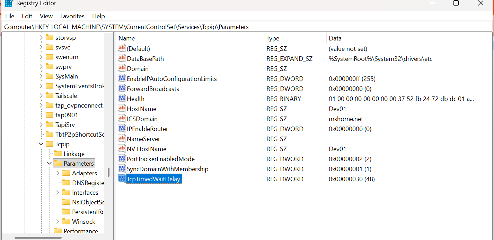

### 10.3 Verifikasi Handshake
Setelah optimasi diterapkan, k6 dapat menangani koneksi simultan ribuan VU tanpa hambatan di fase *ramp-up*:

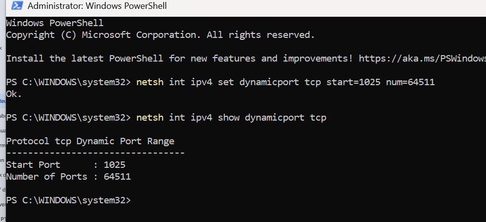

---

*Dibuat untuk Tim QA & Performance Testing*
